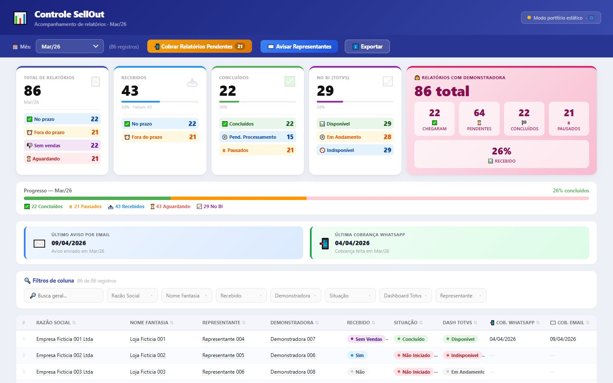

# Controle Sell Out

Painel que acompanha, mês a mês, o recebimento dos relatórios de sell out de cada loja: o que chegou no prazo, o que está atrasado, o que já foi processado e o que já está no BI. As pendências viram cobranças por WhatsApp e e-mail, registradas na própria planilha.

**[Ler o estudo de caso](https://lariantunez.github.io/painel-acompanhamento-relatorios-sellout/)** · **[Abrir a demo do painel](https://lariantunez.github.io/painel-acompanhamento-relatorios-sellout/painel/)**



> **Versão de portfólio.** O painel original roda em produção, lendo uma planilha Google real. Esta versão usa dados fictícios locais e não chama a API do Apps Script.

## O problema

Todo mês, a equipe precisa saber quais lojas já mandaram o relatório de vendas, quais estão fora do prazo e quanto já está no BI. O controle ficava numa planilha, e cobrar quem faltava significava montar mensagem por mensagem.

## O que eu construí

- **API sobre a planilha:** um Google Apps Script publicado como aplicativo web transforma a planilha em uma API JSON, sem servidor para manter.
- **Cartões que filtram a tela:** 16 recortes clicáveis, e cada número mostra exatamente as lojas por trás dele.
- **Cobrança em lote:** pendências agrupadas por representante, com mensagem pronta no WhatsApp Web e assistente de e-mail em 4 passos. Cada cobrança grava data e hora na planilha.
- **Atualização a cada 5 segundos** sem perder os filtros, e exportação em Excel, CSV e PDF.

## Decisões técnicas

- **A planilha continua sendo a fonte.** A equipe já trabalhava nela; o painel só lê, resume e escreve de volta o que ele mesmo produz, que são as datas de cobrança.
- O Apps Script lê as colunas pelo nome, não pela posição, e descobre sozinho as abas mensais (padrão `AA_Mmm`).
- Todos os cálculos acontecem no navegador, a partir da lista que o script devolve.

## Stack

Google Apps Script · Google Sheets · JavaScript · SheetJS

## Estrutura

| Caminho | Conteúdo |
|---|---|
| `index.html` e `assets/` | Estudo de caso em 9 capítulos |
| `painel/index.html` | Painel em modo portfólio, com dados fictícios locais |
| `apps-script_6.js` | Backend em Google Apps Script (7 funções) |
| `codigo-original/` | Cópias do painel e do Apps Script originais, sem URLs nem dados reais |

## Rodar localmente

```bash
npx serve .
```

---

**🇺🇸 English:** a dashboard that tracks, month by month, which stores have sent their sell-out reports: on time, late, processed or already in the BI. A Google Apps Script web app turns the spreadsheet into a JSON API with no server to maintain; every number on screen is a clickable filter; and pending stores become batched WhatsApp and e-mail follow-ups that are written back to the sheet. Stack: Google Apps Script, Google Sheets, JavaScript, SheetJS. Portfolio version with fictional data; the original runs in production.
